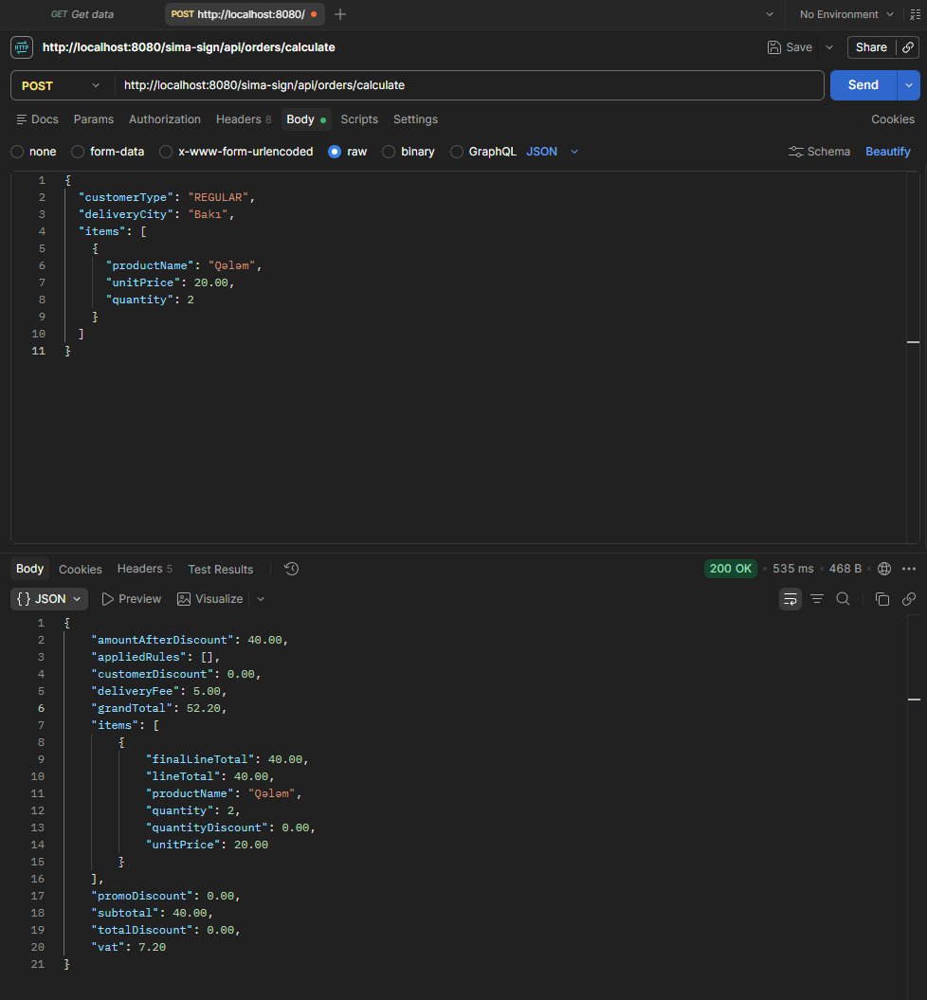
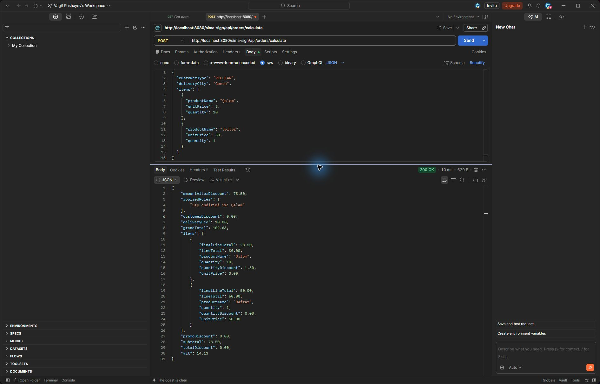
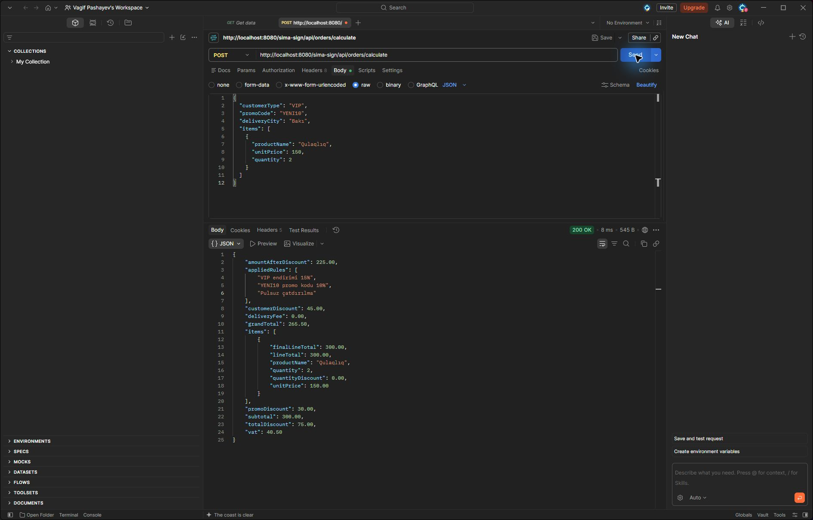
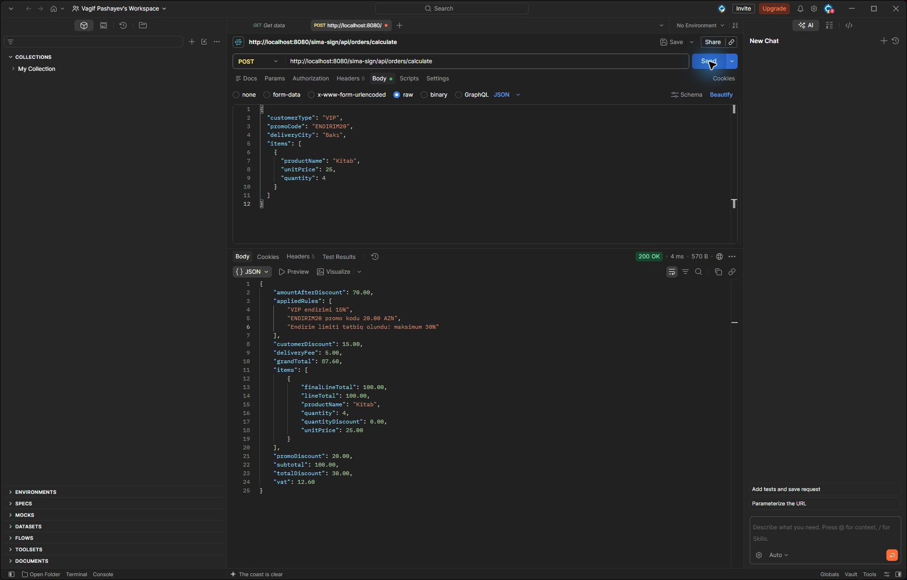
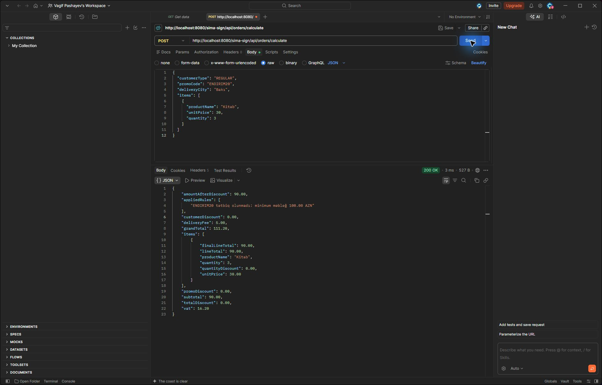
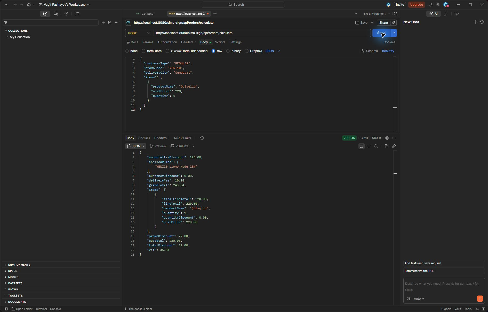
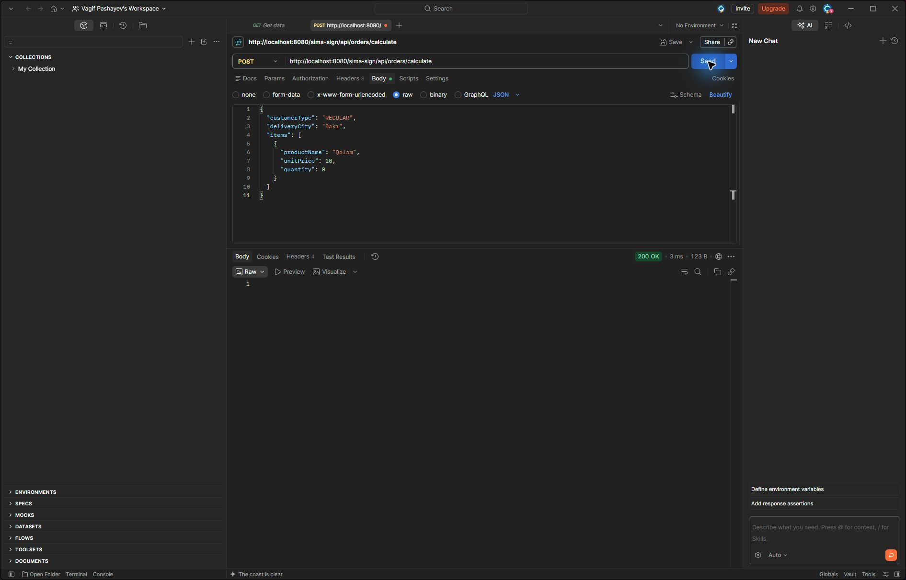
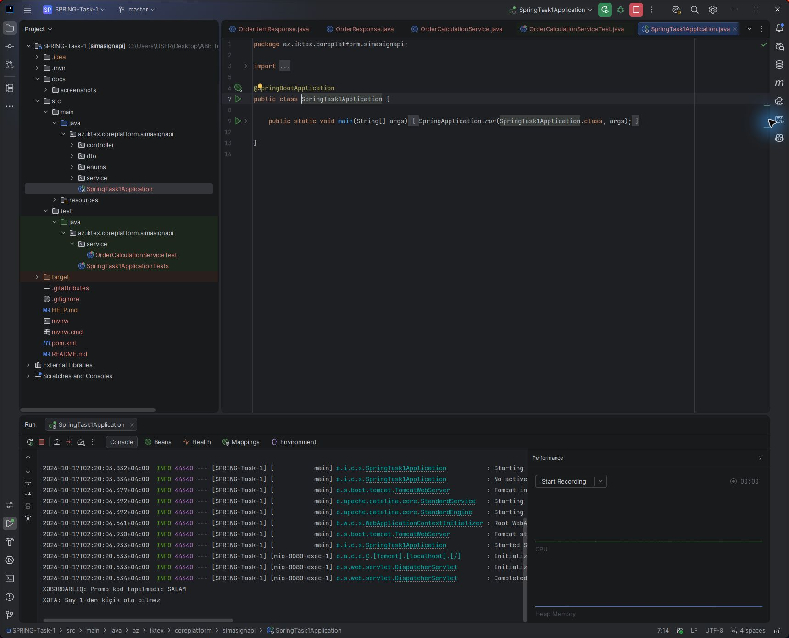

# SPRING-Task-1

Sifarişin məhsul məbləğini, endirimlərini, ƏDV-ni və çatdırılma haqqını hesablayan API.

Java 21, Spring Boot 4.1.1, Maven və JUnit 5 istifadə olunur. Verilənlər bazası yoxdur.
Controller sorğunu service-ə ötürür, yoxlama və hesablamalar `OrderCalculationService` daxilindədir.
DTO-lar adi Java sinifləridir, Lombok və record istifadə olunmur.

## İşə salmaq

JDK 21 lazımdır. Maven Wrapper layihəyə daxildir; ilk işə salınmada asılılıqların yüklənməsi üçün internet lazımdır.

Windows PowerShell-də layihənin qovluğunda:

```powershell
.\mvnw.cmd spring-boot:run
```

IntelliJ IDEA-da `pom.xml` faylını Maven layihəsi kimi açıb `SpringTask1Application` sinfini də işə salmaq olar.

## Sorğu

```http
POST http://localhost:8080/sima-sign/api/orders/calculate
Content-Type: application/json
```

Postman-da `Body → raw → JSON` seçilir.

```json
{
  "customerType": "VIP",
  "promoCode": "YENI10",
  "deliveryCity": "Bakı",
  "items": [
    {
      "productName": "Qulaqlıq",
      "unitPrice": 150.00,
      "quantity": 2
    }
  ]
}
```

`customerType`: `REGULAR` və ya `VIP`. `promoCode` göndərilməyə bilər.
Şəhər və ən azı bir məhsul mütləqdir. Məhsulun adı boş olmamalı, qiyməti sıfırdan böyük,
miqdarı isə ən azı 1 olmalıdır.

Cavabda hesablanmış məhsullar (`items`), `subtotal`, `customerDiscount`, `promoDiscount`,
`totalDiscount`, `amountAfterDiscount`, `vat`, `deliveryFee`, `grandTotal` və `appliedRules` qaytarılır.
Yuxarıdakı sorğu üçün yekun məbləğ `265.50` AZN-dir.

## Hesablama ardıcıllığı

1. Hər məhsul üçün qiymət miqdara vurulur.
2. Miqdar 10 və daha çox olduqda həmin məhsul sətrinə 5% endirim edilir.
3. Sətirlərin endirimdən sonrakı məbləğləri toplanır: `subtotal`.
4. VIP müştəriyə `subtotal` üzərindən 15% endirim hesablanır.
5. `YENI10` üçün `subtotal`-ın 10%-i; `ENDIRIM20` üçün isə `subtotal >= 100.00` olduqda 20.00 AZN endirim verilir.
6. VIP və promo endirimlərinin cəmi `subtotal`-ın 30%-ni keçə bilməz.
7. Ümumi endirim `subtotal`-dan çıxılır: `amountAfterDiscount`.
8. Bu məbləğin 18%-i ƏDV kimi hesablanır.
9. `amountAfterDiscount >= 200.00` olduqda çatdırılma pulsuzdur. Əks halda `Bakı`, `BAKI`, `Baku` üçün 5.00, digər şəhərlər üçün 10.00 AZN-dir.
10. `grandTotal = amountAfterDiscount + vat + deliveryFee`.

Pul hesablamaları `BigDecimal` ilə aparılır, məbləğlər 2 onluq yerə `RoundingMode.HALF_UP` ilə yuvarlaqlaşdırılır.
Tətbiq olunan qaydalar `appliedRules` siyahısında göstərilir.

## Yanlış giriş

Service yoxlamasından keçməyən sorğu üçün konsola səbəb yazılır və `null` qaytarılır.
Tapşırığın şərtinə uyğun olaraq bu halda endpoint `200 OK` və boş cavab qaytarır.
Bu davranış service yoxlamalarına aiddir; səhv JSON və ya etibarsız enum dəyəri Spring tərəfindən ayrıca rədd edilə bilər.

Naməlum promo kod sifarişi dayandırmır. Məsələn, `SALAM` üçün konsola
`XƏBƏRDARLIQ: Promo kod tapılmadı: SALAM` yazılır və hesab promo endirimsiz davam edir.

## Testlər

```powershell
.\mvnw.cmd test
```

`OrderCalculationServiceTest` tapşırığın 8 ssenarisini Spring kontekstini açmadan yoxlayır.
7-ci və 8-ci testlər konsola yazılan xəbərdarlıq və xəta mesajını da yoxlayır.
`SpringTask1ApplicationTests` isə Spring kontekstinin açılmasını yoxlayır.

Son yerli yoxlamada 9 test keçib: 8 service testi və 1 kontekst testi.

### Ssenarilər

Aşağıdakı məbləğlər JUnit yoxlamalarında və Postman sorğularında təsdiqlənib.
`Ümumi endirim` sütunu `totalDiscount`-dır; say endirimi artıq `subtotal`-da nəzərə alınıb.

| № | Müştəri / promo / şəhər | Məhsullar: qiymət × miqdar | Subtotal | Ümumi endirim | ƏDV | Çatdırılma | Yekun |
|---|---|---|---:|---:|---:|---:|---:|
| 1 | REGULAR / yoxdur / Bakı | 20.00 × 2 | 40.00 | 0.00 | 7.20 | 5.00 | 52.20 |
| 2 | REGULAR / yoxdur / Gəncə | 3.00 × 10; 50.00 × 1 | 78.50 | 0.00 | 14.13 | 10.00 | 102.63 |
| 3 | VIP / YENI10 / Bakı | 150.00 × 2 | 300.00 | 75.00 | 40.50 | 0.00 | 265.50 |
| 4 | VIP / ENDIRIM20 / Bakı | 25.00 × 4 | 100.00 | 30.00 | 12.60 | 5.00 | 87.60 |
| 5 | REGULAR / ENDIRIM20 / Bakı | 30.00 × 3 | 90.00 | 0.00 | 16.20 | 5.00 | 111.20 |
| 6 | REGULAR / YENI10 / Sumqayıt | 220.00 × 1 | 220.00 | 22.00 | 35.64 | 10.00 | 243.64 |
| 7 | REGULAR / SALAM / Bakı | 10.00 × 1 | 10.00 | 0.00 | 1.80 | 5.00 | 16.80 |
| 8 | REGULAR / yoxdur / Bakı | 10.00 × 0 | — | — | — | — | Boş cavab |

## Postman nəticələri

Hər ssenaridə `200 OK` alınıb. 8-ci ssenaridə cavabın gövdəsi boşdur.

### Ssenari 1



### Ssenari 2



### Ssenari 3



### Ssenari 4



### Ssenari 5



### Ssenari 6



### Ssenari 7


### Ssenari 8



### Konsol mesajları

7-ci ssenaridə naməlum promo kod üçün xəbərdarlıq, 8-ci ssenaridə isə say xətası yazılır.


